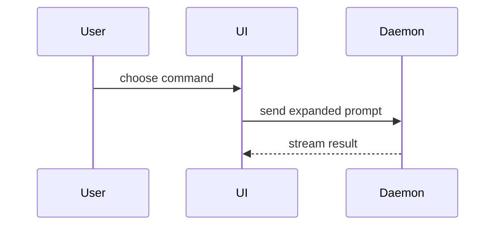

The Ketcher adaptation of `pr` from `mattpocock/skills`. The _Sections_ text is upstream, word for word; each **In Ketcher** paragraph adds what this repo needs.

Write the PR body as `.github/pull_request_template.md`, filled in. Its first three sections are the upstream template; PR type and Check list follow. `gh pr create --body-file` leaves the template out, so copy every heading in order.

A large-scale change uses `.github/PULL_REQUEST_TEMPLATE/large-scale-change.md`. Add the Merge Danger section to it; its Revert plan answers the door.

## Title

`#<issue> - <issue title>`. With no issue, a short plain title.

## Sections

Skip all preambles and keep prose brief. Use the user's domain language from `.memory-bank/glossary.md`.

### Summary

Pick the smallest view that makes the key point clear.

- Show logic or an algorithm as pseudocode:

```text
on(save)
  if content is unchanged
    return cached result
  write new content
  return fresh result
```

- Show runtime control flow as a call tree:

```text
submitForm
  createSession
    persistPrompt
    launchAgent
  navigateToSession
```

- Show UI structure as a component tree, including state and module boundaries that matter:

```text
<SessionPage> (apps/example/src/routes/session.tsx)
  useSessionEvents()
  <SessionToolbar>
    <RunSkillButton> (packages/ui)
```

- Show file responsibility or a broad refactor as a shallow file tree:

```text
src/
├── commands/       # parses user actions
├── sessions/       # owns session state
└── transport/      # sends API requests
```

- Show component interaction, control flow, or data flow with Mermaid:



- Use `diff` when the point is what changes and the surrounding shape already exists. Match the diff shape to the topic.

For a component change:

```diff
 <SessionPage>
   useSessionEvents()
   <SessionToolbar>
+    <RunSkillButton />
   <SessionTimeline>
+    <SkillResultCard />
```

For a file-layout change:

```diff
 src/
 ├── commands/
+│   └── show-me.ts       # expands the slash command
 ├── sessions/
-└── transport.ts
+└── transport/
+    ├── client.ts
+    └── stream.ts
```

For a call-tree or call-stack change:

```diff
 submitForm
   createSession
     persistPrompt
+    expandSkillMention
     launchAgent
-  navigateToSession
+  navigateToSession
+    subscribeToEvents
```

For a state or control-flow change:

```diff
 on(save)
-  write content
+  if content is unchanged
+    return cached result
+  write new content
+  invalidate cache
```

- Show the whole block when most of it is new, when omitted context would hide ownership or order, or when the user needs a copyable target shape:

```ts
function expandSkill(command: string): string {
  const skillName = command.slice(1);
  return `use the ${skillName} skill`;
}
```

#### Guidance

Place each visual next to the short text it supports. Keep only the calls, files, props, states, and boundaries needed to answer the user's current question or the options to resolve the current discussion point.

You may use one of these, you may use several, it is unlikely you will use all of them. Use your judgement and don't overwhelm the user.

**In Ketcher:** draw from the diff's real names: `CoreEditor` calls, `ketcher-core` and `ketcher-react` modules, React components.

### Evidence

Concrete evidence that the change works. Show a before and after.

Screenshots are S-tier - when the environment is set up for it and the change is visual.

Execution-based evidence is A-tier. Test results, console output. Show the exact test that now fails and passes, using pseudocode.

**In Ketcher:** for a change a user can see in the editor, put the `verify-ketcher` result under a `### Verified in the app` subheading: the feature, the mode, the result, and what the exported structure showed. With nothing visible, write `Verified in the app: n/a` and the reason.

### Merge Danger

Describe whether it's a one-way or two-way door. You can walk back through two-way doors, but not one-way doors. A PR that is cheap to roll back is lower risk. Changes that involve destructive actions or hard-to-reverse decisions are one-way doors.

The blast radius is the potential impact or scope of the changes introduced by this PR. Consider all possibilities. Examples are layout shift, breakages for consumers, mobile responsiveness, etc.

**In Ketcher:** one-way doors here include a changed KET or MOL output, a removed or renamed public API of `ketcher-core` or `ketcher-react`, and settings saved in users' local storage. For blast radius, check both editor modes (molecules and macromolecules), file format round trips, `ketcher-standalone` and remote mode, and API consumers.

## PR type and Check list

Tick the one PR type row that matches, and only the checklist items that are true. After the checklist, add:

- `Closes #<N>` for each issue the PR fixes;
- `Memory bank:` and the file the PR updated, or `not needed`.
